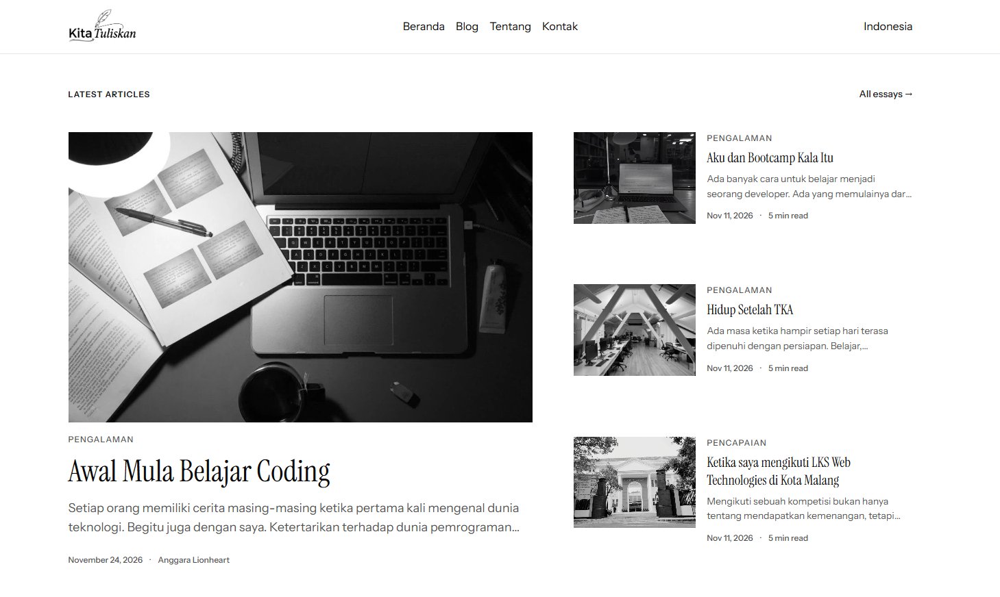

# Kita Tuliskan

**Kita Tuliskan** is a personal blogging platform built to share stories, thoughts, experiences, and ideas through writing. Designed with a minimalist approach to provide a simple and comfortable reading experience.

## Preview



## Tech Stack

- Go
- React
- Astro

## Getting Started

### Prerequisites

Make sure you have the following installed:

- Go
- Node.js
- npm
- Make

### Installation

Clone the repository:

```bash
git clone https://github.com/anggathestarboy/kitatuliskan.git
cd kitatuliskan
```

Install dependencies:

```bash
make install
```

### Development

Run the development environment:

```bash
make dev
```

## License

This project is intended for personal use and development.